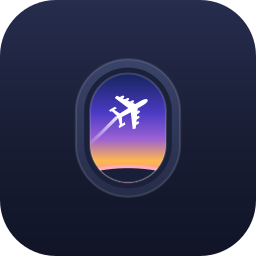
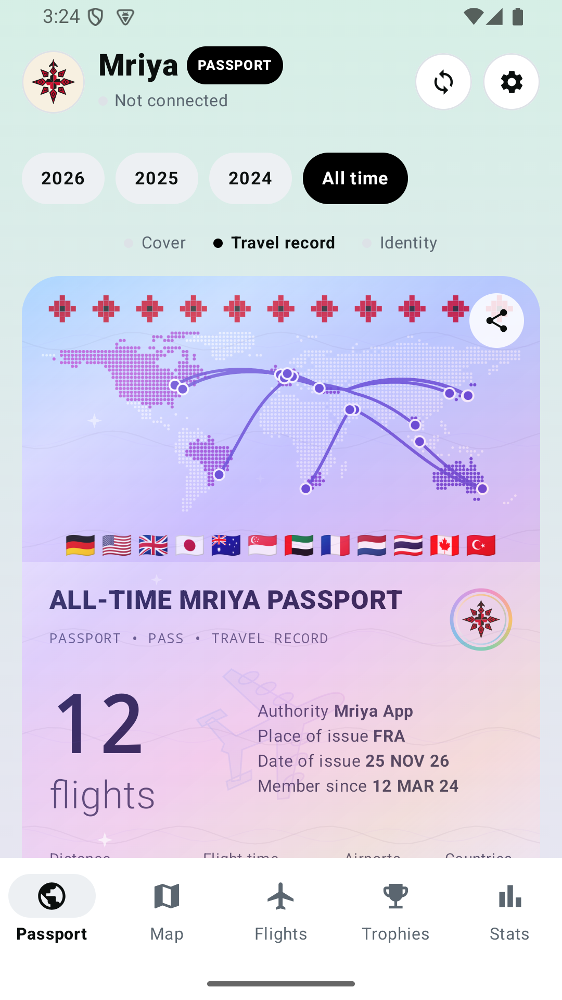
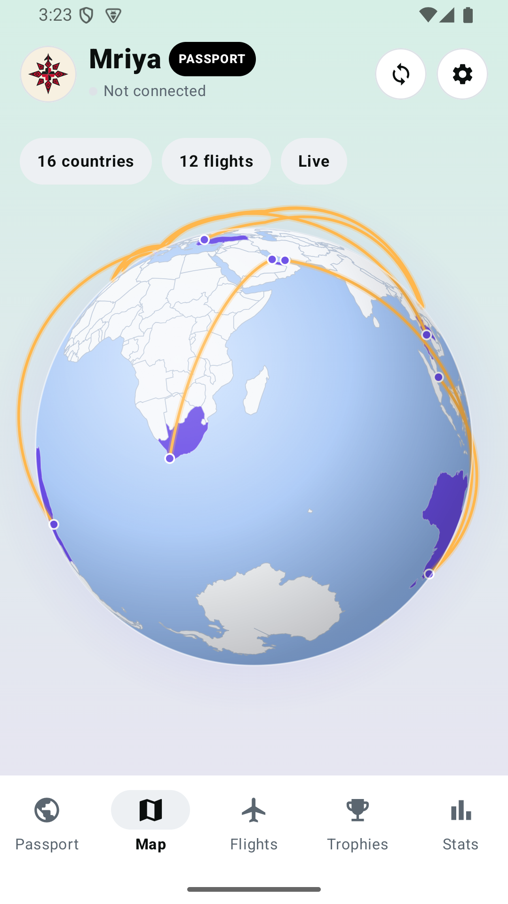
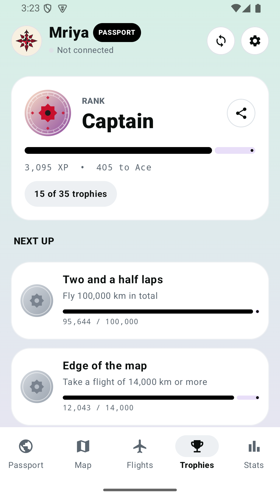
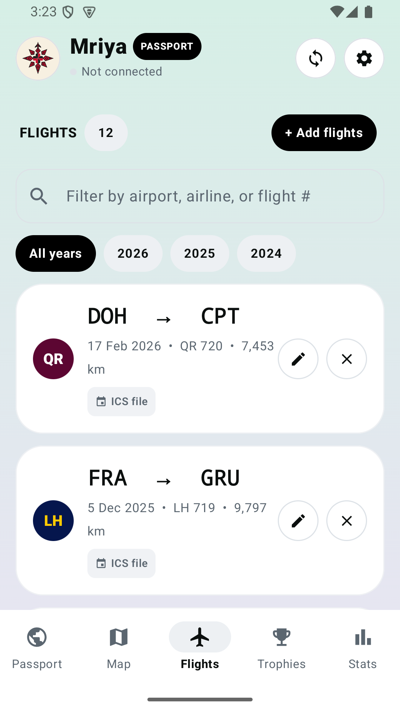
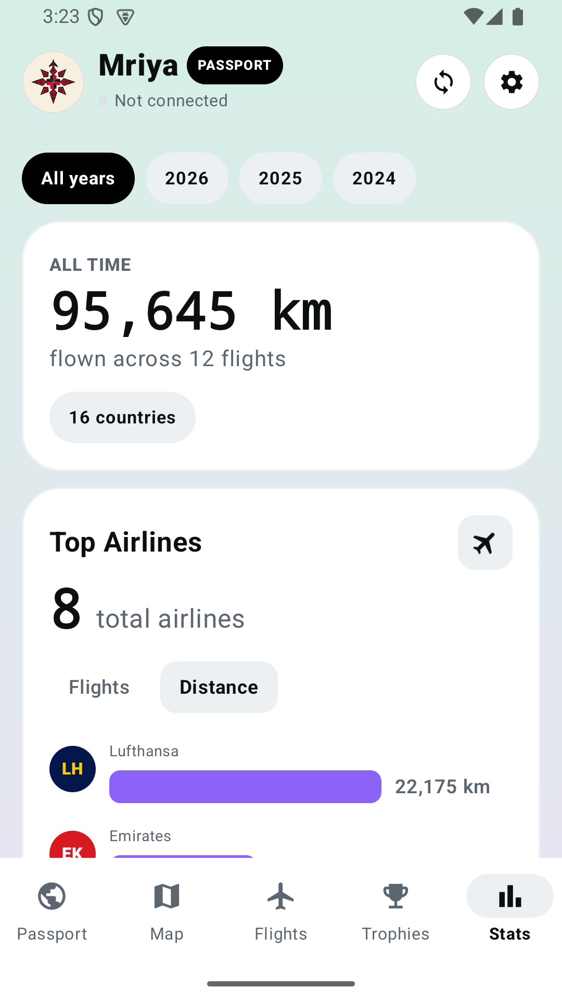
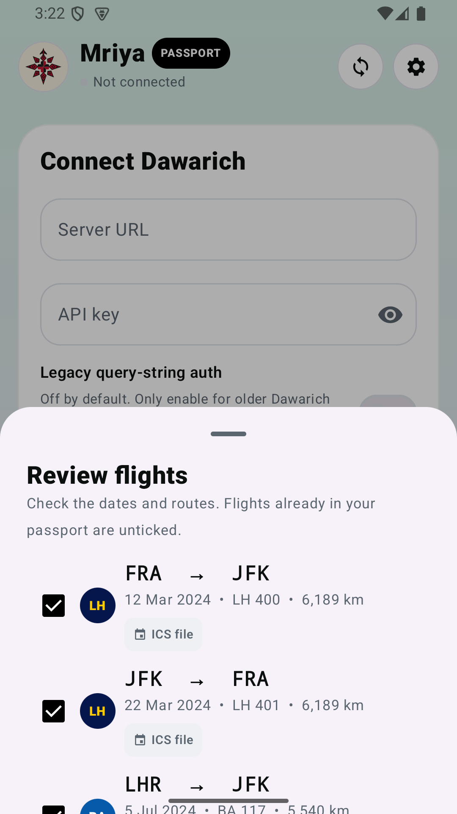

<p align="center"></p>

<h1 align="center">Mriya: Travel Passport for Android</h1>

<p align="center">
  <a href="https://github.com/oleh11/mriya/releases/latest"></a>
  <a href="https://github.com/oleh11/mriya/releases"></a>
  <a href="LICENSE"></a>
  
  
  
</p>

---

> **Mriya** (*мрія*) means **"dream"** in Ukrainian 🇺🇦.
> A privacy-first travel passport: country stamps, auto-detected flights and a 3D globe, built from your own
> [Dawarich](https://dawarich.app) location history, Google Takeout, or your booking emails. No account, no tracking, no ads.

---

## 📱 App Preview

<p align="center">
  
  
  
</p>
<p align="center">
  
  
  
</p>

<p align="center"><sub>Screenshots use invented sample flights.</sub></p>

---

## 📥 Download & Install

| Where | How |
| :--- | :--- |
| **Direct APK** | [**Download the latest Mriya.apk**](https://github.com/oleh11/mriya/releases/latest/download/Mriya.apk) |
| **Obtainium** (auto-updates from GitHub) | [**Add to Obtainium**](https://apps.obtainium.imranr.dev/redirect?r=obtainium://add/https://github.com/oleh11/mriya) |

> **Sideloading:** allow *"Install from this source"* when Android asks. Requires Android 8.0 or newer. Works on GrapheneOS
> and other phones without Google Play services.

---

## ✨ Key Features

- **Passport**: a two-page holographic passport deck (Travel Record + encrypted on-device Identity page) with procedural vyshyvanka-inspired country stamps, 7 rank seals, full-screen pinch/pan viewer, and one-tap PNG export.
- **Trophies and ranks**: 35 trophies (countries, continents, flights, distance, records, firsts), XP and a rank ladder topped by Mriya, the largest aircraft ever built. Share a trophy card: it shows only the trophy, your rank and totals, never places or dates.
- **Remove what is wrong**: tap a country on the globe, or a stamp, and remove it if you were never there. Its flights are hidden too, you can undo it, and your choice survives a resync.
- **Flight detection & import**: finds past flights in your Dawarich history, imports Google Takeout `.zip`/`.json` archives locally (streaming parser that discards raw GPS points), lets you search/filter flights by year, tag or edit airline/flight metadata on any flight, look up flight # + date via opt-in BYOK AeroDataBox or FlightAware, or import from bookings, boarding passes, calendars, `.ics`, or manual entry.
- **3D globe & live tracking**: a native, fully offline globe (drag, pinch, fling, tap countries or flight arcs, accessible visited-countries list), plus opt-in live airborne tracking via free open ADS-B feeds (`adsb.lol` / `airplanes.live`). No map tiles, no third-party map servers.
- **Stats**: all-time totals, per-year breakdown, and **Top Airlines** ranked by distance or flight count.
- **Passphrase-encrypted backup**: export and restore user stamps, flights, Takeout results, and holder identity in an offline `MRY1` (PBKDF2-SHA256 + AES-256-GCM) archive. Dawarich server URL and API key are never included.
- **Background sync**: resumable, checkpointed sync via WorkManager with atomic `.bak` recovery; optional periodic sync.

## 🔒 Privacy and security

- Your Dawarich API key, holder profile, and portrait photo are stored encrypted with a key in the Android Keystore; the API key is sent as a `Bearer` header, with legacy `?api_key=` fallback off by default.
- HTTPS only in release builds. App data is excluded from cloud backup and device transfer.
- The globe, airports and country outlines are bundled, so nothing about where you look leaves the device.
- Flight and Google Takeout imports run locally: no telemetry, no closed-source Play Services. Email import works by sharing or pasting a booking email; an optional, off-by-default Gmail connection (read-only, your own Google client id, see [docs/GMAIL_SETUP.md](docs/GMAIL_SETUP.md)) can search your mail on demand. Calendar access is optional and only requested when you tap Scan my calendar.
- See [PRIVACY.md](PRIVACY.md), [SECURITY.md](SECURITY.md), and [docs/STORAGE.md](docs/STORAGE.md).

## 💻 Build from source

Open the project in Android Studio (JDK 21), or:

```
./gradlew testDebugUnitTest lintDebug assembleDebug
```

Then connect your Dawarich server or import Google Takeout in **Settings**.

## 🗺️ Data sources

Airports: [OurAirports](https://ourairports.com/data/) (public domain). Country outlines: [Natural Earth](https://www.naturalearthdata.com/) (public domain).

## 📄 Status

Active development (`v0.4.1`). Licensed under the [GNU GPL v3](LICENSE).
